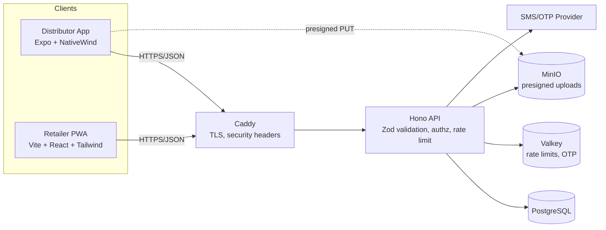

# Original Brief — Distributor Manager (Phase 1 POC)

> **Status:** Requirements baseline. This is the original brief, kept verbatim.
> Where it conflicts with [`memory/DECISIONS.md`](../memory/DECISIONS.md), **DECISIONS.md wins**.
> Main overrides: the distributor app is native **Kotlin** (not Expo), the DB choice was reviewed (ADR-002),
> object storage was reviewed (ADR-004), and UI prototypes are built as Artifacts with a review loop before any server work (ADR-005).

---

## Role
You are a senior full-stack engineer and product designer. Build a production-grade POC for **Distributor Manager**: a system where distributors manage inventory and retailers, and retailers place orders by scanning the distributor's QR code. Prioritize clean, modern, typed code; security and rate limiting are first-class requirements, not afterthoughts. The entire stack must be open source and self-hostable.

Work in the phases below. **Do not start a phase until the previous phase's deliverables are done and summarized.** Ask me before making irreversible choices not covered here.

---

## 1. Product scope

### Actors
| Actor | Surface | Auth |
|---|---|---|
| Distributor | Mobile app (iOS/Android) | Phone OTP → JWT session |
| Retailer | Mobile-first responsive web app (opened via QR scan) | Phone OTP, scoped to the scanned distributor |

### Distributor app features
1. **Onboarding & login** — phone number + OTP; then business profile (business name, owner name, phone, email optional, address optional, GSTIN optional, logo optional).
2. **Inventory management** — CRUD items: name, SKU (optional), unit (pcs/box/kg/l/etc.), rate (price), available stock qty, image (optional), active/inactive toggle, category (optional). Search, filter, sort. Bulk rate update is a stretch goal.
3. **Retailer management** — add/edit/deactivate retailers. Fields: **name (required), phone (required, unique per distributor)**, email, address, shop photo, location (lat/lng or place name). Search and list.
4. **QR code** — generate the distributor's QR (encodes `https://<web-domain>/d/<publicSlug>`). Show, download as PNG, share via native share sheet. Allow regenerating the slug (invalidates old QR).
5. **Orders inbox** — list orders by status, order detail view. Per line item the distributor can set `acceptedQty` (0 … requestedQty). Actions: **Accept all**, **Accept partial** (edit per-line quantities, optional note per line), **Reject** (with reason). Then mark **Dispatched → Delivered**.
6. **Dashboard** — today's orders, pending count, low-stock items.

### Retailer web app features
1. Scan QR → lands on `/d/<publicSlug>` showing distributor name/logo.
2. Enter mobile number → OTP. **If the number is not registered as a retailer of that distributor, show a generic "Contact your distributor to get access" screen** (do not reveal whether the number exists elsewhere).
3. Catalog page — distributor's active items with rates, search, category filter, quantity steppers, sticky cart bar.
4. Cart & checkout — review, optional note, place order. Prices are **snapshotted server-side** at order time; never trust client prices.
5. Order history — list + detail with per-line requested vs accepted qty and status timeline. Reorder from a past order.
6. Must feel like a native app: bottom nav, skeleton loaders, pull-to-refresh, installable PWA, safe-area insets, 44px touch targets.

### Order state machine
```
PENDING → ACCEPTED | PARTIALLY_ACCEPTED | REJECTED
PENDING → CANCELLED (by retailer, only while PENDING)
ACCEPTED | PARTIALLY_ACCEPTED → DISPATCHED → DELIVERED
```
Stock is decremented **at acceptance**, inside a DB transaction with row-level locks (`SELECT … FOR UPDATE`). Accepted qty can never exceed available stock. All transitions are validated server-side and written to an `order_events` audit table.

### Out of scope for Phase 1
Payments, invoicing/GST bills, multi-user distributor staff roles, delivery tracking, offline order sync, push notifications (design for them, don't build).

---

## 2. Tech stack (open source, self-hostable)

| Layer | Choice | Why |
|---|---|---|
| Monorepo | pnpm workspaces + Turborepo | Shared types/schemas across apps |
| Language | TypeScript (strict) everywhere | End-to-end type safety |
| Distributor mobile app | Expo (React Native) + Expo Router + **NativeWind v4** (Tailwind) | One codebase iOS/Android, Tailwind parity with web |
| Retailer web app | **React + Vite** PWA, **Tailwind CSS v4**, **shadcn/ui** (Radix), TanStack Router | Light, fast, app-like, no SSR needed |
| Data fetching | TanStack Query (both apps) | Caching, retries, optimistic updates |
| Forms/validation | React Hook Form + **Zod** (schemas in `packages/shared`, reused by API) | Single source of truth for validation |
| API | **Hono** on Node 22 (OpenAPI via `@hono/zod-openapi`) | Fast, typed, small; generates OpenAPI spec |
| DB | **PostgreSQL 16** + **Drizzle ORM** + drizzle-kit migrations | SQL-first, typed, transactional |
| Cache / rate limit / OTP store | **Valkey** (open-source Redis fork) | Sliding-window limits, OTP TTLs |
| Object storage | **MinIO** (S3-compatible) | Shop photos, item images, logos |
| Auth | Custom phone-OTP flow; short-lived JWT access (15 min) + rotating opaque refresh token (hashed in DB) | Full control, no vendor lock-in |
| SMS/OTP | Provider interface with adapters: `console` (dev), MSG91 / Twilio (prod) | Swap without code changes |
| QR | `qrcode` (server) / `react-native-qrcode-svg` (app) | |
| Observability | pino structured logs, OpenTelemetry hooks, `/healthz` `/readyz` | |
| Testing | Vitest, Testcontainers (Postgres/Valkey), Playwright (web), Maestro (mobile, stretch) | |
| Deploy | Docker Compose; one-click on **Coolify** (open-source PaaS) on any VPS; Caddy for TLS | Fully self-hosted, free to run |
| CI | GitHub Actions: lint, typecheck, test, build, `pnpm audit`, CodeQL, Trivy image scan | |

If you believe a choice is wrong for this scope, propose an alternative with a one-paragraph trade-off before switching.

### Architecture


### Repo layout
```
apps/
  distributor-app/   # Expo
  retailer-web/      # Vite PWA
  api/               # Hono
packages/
  shared/            # Zod schemas, types, constants, order state machine
  ui-tokens/         # Tailwind theme tokens shared by NativeWind + web
  config/            # eslint, tsconfig, prettier
infra/
  docker-compose.yml, Caddyfile, .env.example
docs/
  ARCHITECTURE.md, API.md (generated OpenAPI), SECURITY.md, RUNBOOK.md
```

---

## 3. Data model (Postgres, Drizzle)
All IDs are UUIDv7. All tables have `created_at`, `updated_at`. Money stored as `numeric(12,2)` (or integer paise) — never float.

- `distributors` (id, public_slug UNIQUE random 10+ chars, business_name, owner_name, phone UNIQUE, email, address, gstin, logo_key, status)
- `items` (id, distributor_id FK, name, sku, unit, rate, stock_qty, category, image_key, is_active, deleted_at) — index `(distributor_id, is_active)`
- `retailers` (id, distributor_id FK, name, phone, email, address, shop_photo_key, lat, lng, location_label, is_active) — UNIQUE `(distributor_id, phone)`
- `orders` (id, distributor_id, retailer_id, order_no per-distributor sequence, status, note, total_requested, total_accepted, idempotency_key UNIQUE per retailer)
- `order_items` (id, order_id, item_id, item_name_snapshot, unit_snapshot, rate_snapshot, requested_qty, accepted_qty, line_note)
- `order_events` (id, order_id, actor_type, actor_id, from_status, to_status, payload jsonb, created_at) — append-only
- `sessions` (id, subject_type, subject_id, refresh_token_hash, device_info, ip, expires_at, revoked_at)
- `otp_attempts` live in Valkey only (hashed OTP, TTL 5 min)

Enforce tenant isolation: **every query on tenant data filters by `distributor_id` derived from the authenticated session, never from request params.** Add Postgres Row-Level Security as defense-in-depth (set `app.distributor_id` per transaction).

---

## 4. API (REST, versioned `/v1`, OpenAPI generated)
Distributor (`/v1/d/...`, bearer token, subject=distributor):
- `POST /auth/otp/request`, `POST /auth/otp/verify`, `POST /auth/refresh`, `POST /auth/logout`
- `GET|PATCH /me`, `POST /me/qr/rotate`
- `GET|POST /items`, `GET|PATCH|DELETE /items/:id`
- `GET|POST /retailers`, `GET|PATCH|DELETE /retailers/:id`
- `GET /orders?status=&cursor=`, `GET /orders/:id`, `POST /orders/:id/decision` (body: per-line acceptedQty, reason), `POST /orders/:id/status`
- `POST /uploads/presign` (returns presigned PUT, constrained content-type + max size)

Retailer (`/v1/r/:publicSlug/...`, subject=retailer, token bound to distributor_id):
- `GET /` public distributor card (name, logo only)
- `POST /auth/otp/request`, `POST /auth/otp/verify`, `POST /auth/refresh`, `POST /auth/logout`
- `GET /catalog`, `POST /orders` (requires `Idempotency-Key` header), `GET /orders`, `GET /orders/:id`, `POST /orders/:id/cancel`

Conventions: cursor pagination, RFC 9457 problem+json errors, ETag on catalog, consistent error codes in `packages/shared`.

---

## 5. Security requirements (mandatory)
- **OTP**: 6 digits, CSPRNG, stored hashed (HMAC-SHA256 w/ server secret), TTL 5 min, max 5 verify attempts then invalidate, 30 s resend cooldown, constant-time compare. Generic responses to prevent phone enumeration.
- **Retailer authz**: OTP is only sent if the phone is an active retailer of that distributor; response is identical either way. Retailer token embeds `distributor_id` + `retailer_id`; cross-distributor access must be impossible (write tests for it).
- **Tokens**: access JWT (EdDSA/ES256, 15 min, `aud`/`iss` checked); refresh tokens opaque, hashed, rotated on every use with reuse detection → revoke the whole session family. Mobile: store in `expo-secure-store`. Web: refresh token in `HttpOnly; Secure; SameSite=Strict` cookie, access token in memory only.
- **Rate limiting** (Valkey sliding window, return `429` + `Retry-After` + `RateLimit-*` headers):
  | Endpoint | Limit |
  |---|---|
  | OTP request | 3 / 15 min per phone, 10 / hour per IP, global circuit-breaker on SMS spend |
  | OTP verify | 5 / OTP, 20 / hour per IP |
  | Place order | 10 / min per retailer |
  | Authenticated reads | 120 / min per subject |
  | Public `/r/:slug` | 60 / min per IP |
  | Uploads presign | 20 / hour per subject |
- **Input**: Zod-validate every body/query/param; strict schemas (`.strict()`); length caps; normalize phones to E.164 (`libphonenumber-js`).
- **Uploads**: presigned PUT only, allowlist `image/jpeg|png|webp`, max 2 MB, random object keys, server-side re-encode + EXIF strip (sharp) via a post-upload job, serve via short-lived signed GET URLs.
- **Transport/headers**: HTTPS only, HSTS, strict CSP, `X-Content-Type-Options`, `Referrer-Policy`, `Permissions-Policy`; CORS allowlist (retailer web origin only).
- **QR slug**: random, non-guessable, rotatable; never expose internal UUIDs in QR.
- **Concurrency**: stock decrement in transactions with row locks; idempotency keys on order creation.
- **Secrets**: `.env` never committed; `.env.example` with placeholders; validate env with Zod at boot.
- **Logging**: no OTPs, tokens or full phone numbers in logs (mask to last 4).
- **Supply chain**: lockfile committed, Renovate, `pnpm audit`, CodeQL, Trivy, pinned Docker base images, non-root containers.
- Produce `docs/SECURITY.md` with a STRIDE threat model and OWASP ASVS L1 checklist status.

---

## 6. UI/UX design system
- Mobile-first, 360–430 px primary viewport; web app scales gracefully to tablet/desktop as a centered app shell (max-w ~480 px) — it must look like a native app, not a website.
- Tailwind tokens shared via `packages/ui-tokens`: brand primary (deep indigo), success/warn/danger, neutral scale, radius `xl/2xl`, 4-pt spacing, Inter font.
- Light + dark mode (system default).
- Components: app bar, bottom tab bar, list cells with avatar/thumbnail, item card with qty stepper, sticky cart summary, status chips (color per order status), bottom sheets, toasts, empty states, skeletons, OTP input (6 boxes, auto-advance, paste, SMS autofill `autocomplete="one-time-code"`).
- Accessibility: WCAG 2.2 AA contrast, labels on all inputs, focus rings, respects reduced motion.
- Microinteractions: subtle transitions (Framer Motion on web, Reanimated on mobile), haptics on mobile actions.
- i18n-ready (strings in resource files; English first, Hindi stretch).

---

## 7. Phased delivery

### Phase 1A — UI prototypes (do this first)
Deliver clickable, high-fidelity prototypes as self-contained HTML + Tailwind pages (mobile frame) using **placeholder JSON fixtures shaped exactly like the planned API responses** (put fixtures in `packages/shared/fixtures`).
- Distributor app screens: Splash, Phone login, OTP, Onboarding profile, Dashboard, Inventory list, Add/Edit item, Retailers list, Add/Edit retailer (with photo + location), My QR, Orders inbox (tabs by status), Order detail with partial-accept editor, Profile/settings.
- Retailer web screens: Distributor landing (from QR), Phone login, OTP, Not-authorized, Catalog, Cart, Order placed confirmation, Order history, Order detail with status timeline.
- Include empty, loading, and error states for each list.
**Stop and present the prototypes for my review before Phase 1B.**

### Phase 1B — Foundation
Monorepo scaffold, shared Zod schemas + state machine, Docker Compose (Postgres, Valkey, MinIO, API, web, Caddy), Drizzle schema + migrations + seed script (1 distributor, 20 items, 5 retailers, 10 orders), env validation, CI pipeline.

### Phase 1C — API
Auth (OTP + sessions), rate limiting middleware, all endpoints above, OpenAPI docs at `/docs` (dev only), tests: unit + integration with Testcontainers, including **tenant-isolation tests, rate-limit tests, partial-acceptance + stock-concurrency tests**. Target ≥80% coverage on `api` and `shared`.

### Phase 1D — Retailer web app
Wire prototypes to the API, PWA manifest + service worker (cache catalog shell only, never auth responses), Playwright E2E: scan → login → order → see history.

### Phase 1E — Distributor app
Expo app wired to the API, secure token storage, image picker + presigned upload, QR generate/share, order decision flow. Build a dev client / APK via EAS (or local `expo prebuild`).

### Phase 1F — Hardening & handoff
Security review against Section 5, Lighthouse ≥90 (perf/a11y/best-practices) on retailer web, `README.md` with one-command local start (`pnpm dev` / `docker compose up`), Coolify deployment guide, known-limitations list, Phase 2 recommendations.

---

## 8. Acceptance criteria (POC is done when)
1. A distributor can sign up, add items and retailers, and show a QR — on a real Android device.
2. A registered retailer scans the QR on a phone browser, logs in via OTP, places an order.
3. An unregistered number cannot see the catalog and cannot learn whether it's registered anywhere.
4. The distributor partially accepts the order; stock updates correctly; the retailer sees requested vs accepted quantities.
5. Two concurrent acceptances cannot oversell stock (proven by test).
6. Rate limits trigger with correct 429 responses (proven by test).
7. The full stack runs on a single VPS via Docker Compose with only open-source components.

## 9. Working rules
- Small, reviewable commits with conventional commit messages.
- No `any`; no disabled lint rules without a comment explaining why.
- Every phase ends with: what was built, how to run it, what's tested, open questions, and risks.
- When requirements are ambiguous, state your assumption explicitly in the summary rather than silently guessing.
