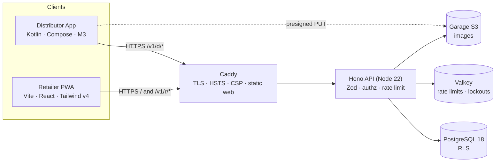
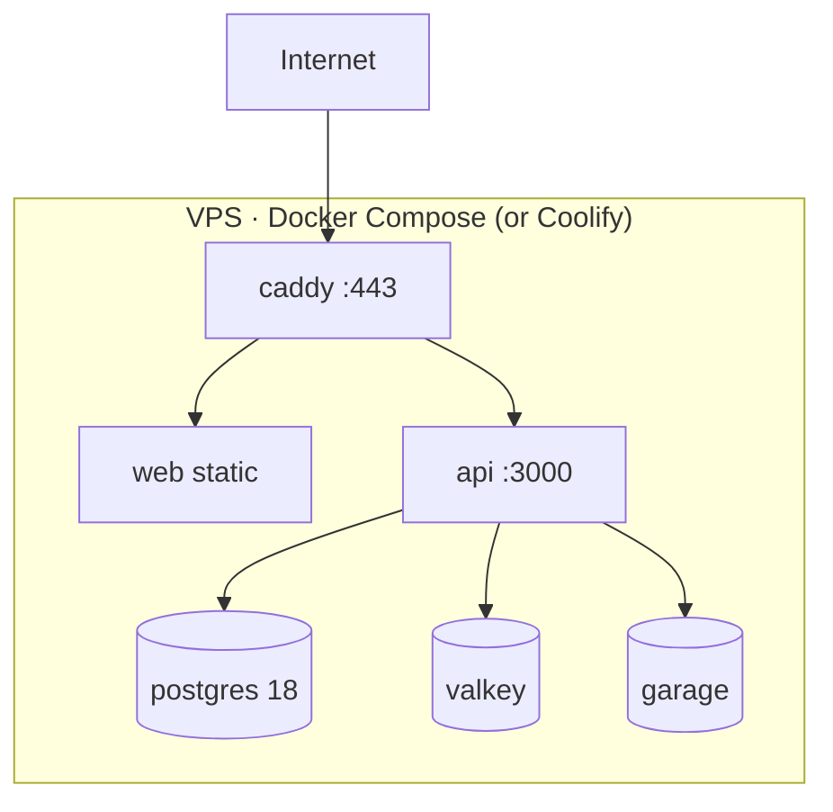

# HLD — DistributeKaro · Phase 1 POC

> Requirements: [`BRIEF.md`](BRIEF.md) · Overrides: [`../memory/DECISIONS.md`](../memory/DECISIONS.md) · Details: [`LLD.md`](LLD.md) · Screens: [`UI-SPEC.md`](UI-SPEC.md)

## 1. Goal
Distributors manage their **catalog with private stock tracking** (sold vs remaining) and their retailers from an **Android app**. Retailers scan the distributor's **QR code** and land on the distributor's **storefront**, a pitch page designed to win retailers. From there, in a **mobile web PWA**:
- **Registered** retailers go straight in and place orders.
- **Unregistered** visitors can send an enquiry or ask to be added.

The distributor accepts each order fully or partially, or rejects it, then marks it dispatched and delivered. Everything is open source and self-hostable on one VPS.

## 2. What changed vs the brief
| Area | Brief | Now | Ref |
|---|---|---|---|
| Distributor app | Expo, iOS + Android | **Kotlin + Compose (M3), Android only** | ADR-001 |
| Distributor auth | Phone OTP | **Phone + password** (argon2id) | ADR-012 |
| Retailer auth | Phone OTP, registered only | **Phone only**; unregistered → public page (Enquire / Request access) | ADR-013 |
| SMS provider | MSG91 / Twilio | **Not needed in Phase 1** | ADR-012/013 |
| Stock | Decrement on acceptance, low-stock alerts | Same, plus a **stock ledger** (opening / restock / sale / adjustment) and a **sold vs remaining report**. **Distributor-only**: retailers never see stock and can order freely | ADR-016 |
| Quantity | Integer | **Decimal (3 dp)** for weight/volume units | ADR-011 |
| Contract with mobile | Shared Zod | **OpenAPI → generated Kotlin DTOs** | ADR-003 |
| API framework | Hono | **Hono** (not Express — rationale in ADR-003) | ADR-003 |
| Database | PostgreSQL 16 | **PostgreSQL 18** | ADR-002 |
| Object storage | MinIO | **Garage** | ADR-004 |
| Delivery | UI prototypes first | **Artifacts with a review loop per batch** | ADR-005 |
| New features | — | **Access requests + enquiries** inbox in the distributor app | ADR-013 |
| QR landing | Distributor name/logo card | **Public storefront** (cover, highlights, brands, featured products, service areas), optional public product browsing, CTAs for everyone | ADR-017 |

## 3. System context


## 4. Components
| Component | Responsibility | Tech |
|---|---|---|
| **Distributor App** | Sign-up/login, onboarding, storefront editor, catalog + stock (restock, adjust, sold/remaining report), retailers, access requests & enquiries, QR, order decisions, dashboard | Kotlin 2.x, Compose, M3, Hilt, Retrofit + OkHttp + kotlinx.serialization, Coil 3, Paging 3, DataStore + Tink, Credential Manager, ZXing |
| **Retailer PWA** | Storefront (public), public product browsing, phone entry, not-registered page (enquire/request), catalog, cart, orders, reorder | React 19, Vite, Tailwind v4, shadcn/ui, TanStack Router + Query, RHF + Zod, vite-plugin-pwa |
| **API** | Auth, tenancy, business rules, order state machine, requests/enquiries, uploads, OpenAPI | Hono + `@hono/zod-openapi`, Drizzle, `jose`, `@node-rs/argon2`, `sharp`, pino, OTel |
| **packages/shared** | Zod schemas, DTO types, error codes, order state machine, unit rules, money/qty maths, fixtures | TS |
| **packages/ui-tokens** | Design tokens + generators (CSS / Kotlin) | TS script |
| **PostgreSQL 18** | System of record; RLS for tenant defense-in-depth | |
| **Valkey** | Sliding-window rate limits, login lockouts, upload tickets | |
| **Garage** | Item images, shop photos, logos (private bucket, signed URLs) | |
| **Caddy** | TLS, security headers, serves the PWA, proxies `/v1` and `/media` | |

## 5. Deployment (single VPS)

- One domain (e.g. `app.distributekaro.in`): `/` = PWA, `/d/<slug>` = retailer entry, `/v1/*` = API, `/media/*` = signed image reads.
- Containers are non-root with pinned digests. Only Caddy is exposed. Nightly `pg_dump` + Garage bucket backup.
- Environments: `local` (compose), `staging`, `prod`.

## 6. Key flows
**Distributor sign-up / login**
```mermaid
sequenceDiagram
  participant A as Android app
  participant API
  A->>API: POST /d/auth/signup {phone, password}
  API-->>A: session (onboardingRequired=true)
  A->>API: PATCH /d/me {businessName, ownerName, …}
  API-->>A: DistributorMe (ACTIVE)
  Note over A,API: later: POST /d/auth/login {phone, password}; refresh rotates
```

**Retailer entry**
```mermaid
sequenceDiagram
  participant R as Retailer browser
  participant API
  R->>API: GET /r/{slug}  (storefront for everyone)
  opt browse
    R->>API: GET /r/{slug}/public-catalog
  end
  R->>API: POST /r/{slug}/auth/identify {phone}
  alt active retailer of this distributor
    API-->>R: AUTHENTICATED + refresh cookie
    R->>API: GET catalog → POST orders (Idempotency-Key)
  else not registered
    API-->>R: NOT_REGISTERED {pendingRequest?}
    R->>API: POST /r/{slug}/access-requests  or  /enquiries
    Note over API: Distributor sees it in Requests; approve → retailer created
  end
```

**Order decision:** distributor opens a PENDING order → *Accept all* / *Partial* (per-line `acceptedQty` 0…min(requested, remaining stock), with an optional note) / *Reject* (reason). One transaction locks the order row and then the item rows (`FOR UPDATE`, in id order), checks stock, decrements it, writes `SALE` stock movements, lines, totals and `order_events`. Then *Dispatched* → *Delivered*. The retailer sees requested vs accepted per line.

**Stock:** create item (opening stock) → *Restock* when goods arrive → stock drops automatically on acceptance → *Adjust* (with a reason) for damage or count corrections. Every change is a row in the ledger. **Stock report** = sold qty + ₹ in a period, and remaining now, per item.

**QR rotate:** new random slug. The old URL shows "This QR is no longer valid". Existing retailer sessions stay valid because they're bound to `distributor_id`.

## 7. Security architecture
- **Tenancy:** `distributor_id` comes only from the token. Every query filters by it, plus PG RLS (`set_config('app.distributor_id', …, true)` per transaction, non-owner app role, `FORCE ROW LEVEL SECURITY`).
- **Distributor auth:** argon2id passwords, breached-password list, generic errors, per-phone lockout + per-IP limits.
- **Retailer auth (phone only, ADR-013):** strict rate limits on identify (per IP, per slug). Sessions are bound to `(distributor_id, retailer_id)`. Deactivating a retailer revokes their sessions. A new-device flag shows on orders. Accepted risk: impersonation by number; Phase 2 adds PIN/OTP.
- **Public forms** (enquiry / access request): strict Zod, a honeypot field, per-phone and per-IP limits, and dedupe of pending requests.
- **Tokens:** EdDSA JWT (15 min, `iss`/`aud` checked). Opaque refresh tokens are rotated on every use with reuse detection. Android stores them with Tink + Keystore. Web uses an `HttpOnly; Secure; SameSite=Strict` cookie, with the access token in memory only.
- **Uploads:** presigned PUT (signed type + length ≤ 2 MB) → server re-encode with sharp, EXIF stripped → signed GET.
- **Edge:** HSTS, strict CSP, nosniff, Referrer-Policy, Permissions-Policy. Single origin means no CORS.
- **Logs:** phone numbers masked to the last 4 digits. Never log passwords or tokens.
- **Supply chain:** lockfiles, Renovate, `pnpm audit`, CodeQL (JS + Kotlin), Trivy, Gradle dependency verification.

## 8. Non-functional targets
| NFR | Target |
|---|---|
| API p95 | < 200 ms reads, < 400 ms writes (2 vCPU VPS) |
| Retailer web | Lighthouse ≥ 90; initial JS < 200 KB gz |
| Android | Cold start < 1.5 s mid-range; minSdk 26 |
| Availability | Single VPS best effort; RPO 24 h |
| Accessibility | WCAG 2.2 AA; 48 dp / 44 px targets |
| i18n | English first, strings externalised; Hindi stretch |

## 9. Revised acceptance criteria
1. A distributor can sign up with phone + password, add items and retailers, and show a QR on a real Android device.
2. A registered retailer scans the QR, enters their number, is let in, and places an order (with decimal quantities where the unit allows).
3. Anyone scanning the QR sees the distributor's storefront (and products, if the distributor allows). An unregistered number cannot order or see the ordering catalog/rates (unless shown publicly) or any stock. It can only send an enquiry or an access request, and these show up in the distributor app.
4. Approving an access request creates a retailer who can then log in.
5. The distributor partially accepts an order, stock and the sold/remaining report update correctly, and the retailer sees requested vs accepted (and never stock).
6. Two concurrent acceptances cannot oversell stock; concurrent decision/cancel on one order: exactly one wins (proven by test). Cross-tenant access is impossible (proven by test).
7. Rate limits return correct 429 responses (proven by test).
8. The full stack runs on one VPS via Docker Compose with only OSS components.

## 10. Phases
| Phase | Output | Gate |
|---|---|---|
| **0 Planning** | BRIEF, HLD, LLD, UI-SPEC, memory | Decisions answered ✔ (QA–QD assumptions) |
| **1A UI (Artifacts)** | Fixtures + UI-0…UI-7 | Each batch approved; UI-7 freezes contract v0 |
| **1B Foundation** | Monorepo, shared schemas, tokens, compose, Drizzle + seed, CI | `docker compose up` + CI green |
| **1C API** | All endpoints + tests ≥ 80 % | AC 3, 4, 6, 7 by test |
| **1D Retailer web** | Wired PWA + Playwright | AC 2, 3 |
| **1E Android** | Wired app, release APK | AC 1, 4, 5 on a device |
| **1F Hardening** | SECURITY.md, Lighthouse, README, Coolify guide | AC 8 |

## 11. Top risks
| Risk | Mitigation |
|---|---|
| Retailer impersonation (phone-only) | Rate limits, distributor review of every order, new-device flag, deactivation revokes sessions; PIN/OTP in Phase 2 |
| Fake distributor signups / phone squatting (no verification) | Signup rate limit per IP; phone verification in Phase 2 |
| Spam enquiries / access requests | Honeypot, rate limits, dedupe; open-source PoW captcha (ALTCHA) if needed |
| Stock drift (`stock_qty` ≠ ledger) | Single write path (movements only), same tx, consistency test + nightly check query |
| Decimal maths mismatch between clients and server | Shared milli-unit integer algorithm + cross-language test vectors in fixtures |
| Kotlin DTO drift | Generated from OpenAPI, CI diff |
| Garage gaps | Spike in 1B; SeaweedFS fallback |
